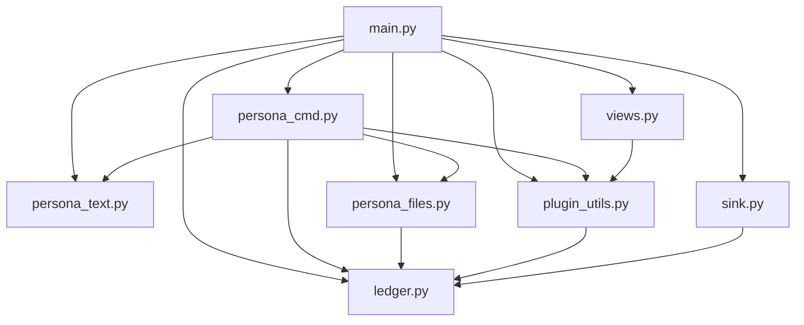

# 依赖地图与 Ledger 切分顺序（待确认）

当前态锚点：副本 `_sandbox_clean`，`HEAD=c54d305`，`baseline` 指向 `8d4fce6`。下文源码行号按 `c54d305` 的实际物理行计，含空行：`ledger.py` **5,142 行**，`main.py` **1,197 行**。交接的 4,086 / 957 是非空行口径；本计划以 **物理行 < 800** 为 `ledger.py` 的验收线，不靠删空行达标。

阶段 1 回归：在副本用 `.\.venv\Scripts\python.exe -m pytest -q --no-header` 实跑，**736 passed, 1 skipped in 25.28s**。本地 AstrBot 替身下，顶层 `main` 和包相对 `_sandbox_clean.main` 都成功导入，分别绑定 `ledger` 和 `_sandbox_clean.ledger`；这不是线上注册或主库验证。本阶段只交此文档，不改源码或测试、不提交。

## 1. 生产态 import 图

箭头为「导入者 → 被导入者」，不代表运行时调用、数据读写或宿主注册。

**没有生产 import 环。** 8 个生产模块、15 条直接本地边；包相对导入和脚本平铺回退得到同一组文件边。依赖先于使用方的一种顺序为 `ledger → persona_text → persona_files → plugin_utils → sink → persona_cmd → views → main`（这是排序，不是逐个相互导入）。

- [main.py:23–56](../main.py#L23) 先导入 AstrBot，再走本地相对导入与 `except ImportError` 平铺分支；缺 AstrBot 不会走此回退。两分支的本地目标相同。`ledger.py` [顶部导入](../ledger.py#L24) 和 [persona_text.py:20](../persona_text.py#L20) 都只依赖标准库。
- [persona_cmd.py:20–28](../persona_cmd.py#L20)、[persona_files.py:16–18](../persona_files.py#L16)、[plugin_utils.py:13–15](../plugin_utils.py#L13)、[sink.py:13–15](../sink.py#L13)、[views.py:12–14](../views.py#L12) 是其余生产边。`ledger.py` [注释中说 `main.AUTO_SINK_TAG`](../ledger.py#L165) 是同字面约束，不是反向导入；`main` 实际从 `ledger` 取两个标记。[main.py:745–746](../main.py#L745) 传 `self` 和文件读取器给 [persona_cmd.py:50–66](../persona_cmd.py#L50)，这是运行时参数，不是 `persona_cmd → main` 的 import。
- **未来成环风险**：凡从 `ledger` 迁出的模块，不能回头导入 `ledger`（也不能借 `main` 或现有四个 `→ ledger` 的外围模块间接回来）。`CommitBuilder` 通过实例调用 `Ledger._seal`，备份预演显式构造 `Ledger`；两者都是需要保留的运行时关系，不应变成反向 import。[ledger.py:2001–2014](../ledger.py#L2001)、[ledger.py:4683–4711](../ledger.py#L4683)。

### 被依赖最多的模块

入度按不同源文件去重，不是 import 语句次数，也不含传递依赖。全仓列包含测试与工具的动态加载，统计口径见下一节。

| 被导入文件 | 生产入度 | 全仓入度 | 直接生产导入者 |
|---|---:|---:|---|
| `ledger.py` | **5** | **28** | `main`、`persona_cmd`、`persona_files`、`plugin_utils`、`sink` |
| `plugin_utils.py` | 3 | 3 | `main`、`persona_cmd`、`views` |
| `persona_files.py` | 2 | 2 | `main`、`persona_cmd` |
| `persona_text.py` | 2 | 3 | `main`、`persona_cmd` |
| `persona_cmd.py` | 1 | 1 | `main` |
| `sink.py` | 1 | 1 | `main` |
| `views.py` | 1 | 1 | `main` |
| `main.py` | 0 | 14 | — |
| `conftest.py`（测试外壳） | 0 | 2 | — |

## 2. 测试、工具及外部依赖

统计范围为 `git ls-files -- '*.py'` 的 **41 个**文件：8 个生产模块、31 个测试、1 个测试外壳、1 个 Python 工具。用副本 venv 的 Python 3.12.15 读取源码、`ast.walk` 枚举 `Import` / `ImportFrom`（包含函数内和异常分支），按同一目标文件合并相对与平铺导入。共 **293** 条 import 语句（生产 63、测试 220、外壳 3、工具 7），其中测试函数内 44 条，未发现 `TYPE_CHECKING` 分支 import。静态得到 52 条本地边，再补三个纯动态边：`test_creative → ledger`、`test_ledger → main`、`test_conftest_coverage_bridge → conftest`。最终 **55 条**（生产 15、测试 39、工具 1）；这份纳入动态加载的本地文件图也没有反向边构成环。忽略 `.venv`、缓存、临时目录和仅由 pytest 自动发现的配置关系。

下表测试文件名省略 `tests/` 和 `.py`；数字是对应测试文件内的证据行，`*` 指动态加载点。通过 `main` 使用重导出符号，不额外计为对原模块的直接 import。

| 测试 | 本地 import 目标 |
|---|---|
| `test_branch_coverage_v6` | `ledger:21`，`main:233` |
| `test_classify_conflict_guards` | `ledger:22` |
| `test_conftest_coverage` | `conftest:16,21*` |
| `test_conftest_coverage_bridge` | `conftest:25*` |
| `test_creative` | `ledger:17*` |
| `test_dream_duty` | `ledger:30,33*` |
| `test_dream_guard` | `ledger:22,25*` |
| `test_emotion_reserved` | `ledger:27,30*` |
| `test_empty_query` | `main:26` |
| `test_group_support` | `ledger:25`，`main:448` |
| `test_ledger` | `ledger:22,27*`，`main:1475*` |
| `test_ledger_coverage` | `ledger:16` |
| `test_ledger_coverage_bridge` | `ledger:15` |
| `test_ledger_edges` | `ledger:18` |
| `test_main_commands` | `ledger:207`，`main:25`、函数内多处、`418*,941*` |
| `test_main_coverage` | `main:27` |
| `test_main_coverage_bridge` | `main:24` |
| `test_memory_duty` | `ledger:26,29*` |
| `test_owners` | `main:24`，另在 13 探测 `astrbot.api` |
| `test_p2_vividness_tier` | `ledger:14` |
| `test_persona` | `ledger:22,27*`，`main:677,910` |
| `test_persona_hardening` | `main:29` |
| `test_persona_render` | `main:26`，`ledger:39` |
| `test_persona_text` | `ledger:17`，`persona_text:18` |
| `test_persona_token` | `ledger:19` |
| `test_persona_write_surface` | 无本地 import；用 AST 扫生产源码（61、115） |
| `test_r3_fixes` | `ledger:19`；另从 Git 加载历史 `954ef20:ledger.py`（22–29、44–50），不算当前图边 |
| `test_r_fixes` | `ledger:26`，`main:50` |
| `test_readme_versions` | `ledger:23` |
| `test_sink_gap` | `main:28` |
| `test_tool_args` | `main:28`，`ledger:50,83` |

- [conftest.py:53–83](../conftest.py#L53) 仅在缺 AstrBot 时在 `sys.modules` 注册替身，不导入 `main`。[test_ledger.py:1414–1480](../tests/test_ledger.py#L1414) 有另一套替身和顶层别名；[test_main_commands.py:931–950](../tests/test_main_commands.py#L931) 构造 `mc_pkg_probe.main` 验证相对导入。[test_creative.py:17–20](../tests/test_creative.py#L17) 会按路径重新执行 `ledger.py` 并替换 `sys.modules['ledger']`；六处 `Ledger.py` 大写文件名回退是现存测试路径，不是另一个模块，也不假定其他平台支持。
- [tools/smoke_baseline.py:11–21](../tools/smoke_baseline.py#L11) 只直接导入平铺 `ledger` 和标准库；不需要 AstrBot。PowerShell 工具不计入 Python 边：[coverage_check.ps1:47–69](../tools/coverage_check.ps1#L47) 和 [rollback_drill.ps1:65–69](../tools/rollback_drill.ps1#L65) 共用 `resolve_python.ps1`；前者依赖 `coverage`、pytest，后者还调用 Git 和 `robocopy.exe`。它们是依赖证据，本阶段未运行回滚或部署工具。
- 生产标准库根（15）：`__future__`、`contextlib`、`contextvars`、`functools`、`hashlib`、`json`、`logging`、`math`、`os`、`pathlib`、`re`、`sqlite3`、`threading`、`time`、`typing`。测试与外壳标准库根（17）：`ast`、`asyncio`、`hashlib`、`importlib`、`inspect`、`json`、`os`、`pathlib`、`re`、`sqlite3`、`subprocess`、`sys`、`tempfile`、`threading`、`time`、`types`、`unittest`；工具另外使用 `shutil`，全仓共 25 个标准库根。
- 唯一的生产第三方 import 是宿主提供的 AstrBot（`astrbot.api`、`.event`、`.star`），[metadata.yaml:11](../metadata.yaml#L11) 声明 `>=4.0.0`。[pyproject.toml:6–13](../pyproject.toml#L6) 声明 Python `>=3.10`、无运行时 pip 依赖，pytest `>=8` 是开发依赖（19 个测试文件直接导入）。`coverage` 是外部工具，不加入运行时依赖。

## 3. Ledger 切分顺序（目标态，尚未实施）

下列行号都在当前 `ledger.py`。表中依赖指新模块的主要导入；条目中的 `self.*`、回调和日志属于原有运行时关系，由门面衔接，不算反向 import。一个表格编号是一刀，9a–9k 也各自验证和提交，不合并生产职责。`persona_text.py` 现在是手写人格**解析**，不要把账本渲染和它混作同一功能。

### 先拆叶子、规则、迁移与提交准备

| 刀次 / 新文件 | 迁出原行号和符号 | 依赖与仍留门面的绑定 |
|---|---|---|
| **1 `ledger_math.py`** | **190–191、195、206–207、804–812、823–955、966–996、1487–1499**。时间格式/解析缓存、`human_ago`、分词与词表、BM25、limit、半衰期、线索权重、保留/冲刷、`_clamp_unit`。 | 只有 `time`、`math`、`re`、`functools`、`typing`；本模块常量随函数搬。同轮先留 **958–963** `time_decay` 和 **999–1023** `working_activation` 在 `ledger`，保留 `_parse_time` 与 `WORKING_ACCESS_HORIZON` 的旧调用时查找，不用静态 import 替代这两个补丁点。 |
| **2 `ledger_constants.py`** | **69–188、193–194、196–198、216–220、226、444–462、511–512、523–559、570–572、785–802、815–820**。API/备份协议值、通用域常量、机器标记判定、投影键、异常类。 | 不依赖项目模块。`LedgerError` 与 `StaleHeadError` 各只有一个定义，门面原名重导出。`WORKING_CAPACITY`、WAL/自动压缩、梦/情感等读取环境变量的定义留在门面，保持初始化时机；原文候选上限和 `WORKING_ACCESS_HORIZON` 也原位。 |
| **3 `ledger_persona_format.py`** | **465–509**。`_compute_persona_core_hash`、`render_persona_rows`。 | `hashlib`、`typing`、`ledger_constants.LedgerError`；保持两条渲染入口各自的 `render_persona_rows` 全局名。`Ledger.persona_text`（**2656–2663**）先留在门面。 |
| **4 `ledger_affect.py`** | **1186–1193、1198–1207、1221–1286、1323–1480**。记忆年龄、元数据与标签、鲜活度豁免、情感信号与 `classify_tier`。 | 标准库 `time`、`json`、`re`、`typing`。**1194–1197、1289–1320** 的环境阈值和 `vividness` 可留门面，继续用原名读阈值，直至能不改变读取时机地适配。源码没有 `affinity` 符号，不凭名称新增功能；坏感度读写是 **1966–1999、3475–3502** 的 `attitude`，归 Builder/画像访问。 |
| **5 `ledger_conflict.py`** | **1026–1052、1064–1183、1209–1217**。条件解析/匹配、冲突分类、否认关键词、梦的禁用标签集合。 | `json` / `typing`、`ledger_math` 时间解析缓存、`ledger_constants` 冲突与否认常量、`ledger_affect` 保护/豁免标签。**1055–1061** `_windows_overlap` 仍走门面的 `_parse_time`。分类函数如需跨模块使用它，门面保留原签名，向私有实现传入原绑定；不把判断复制两份。 |
| **6 `ledger_schema.py`** | **42–67、233–442、575–777**。`SCHEMA_VERSION`、建表 statements、`DEFAULT_META`、从 0→1 到 7→8 的八个步骤。 | `sqlite3`（连接注解），现有 `led` 参数只做接口保留，不需要 import `Ledger`。**780–782** `_MIGRATIONS` 仍在门面按顺序组装；**2111–2124、2188–2209** 保留建表/版本步进、事务、缺步骤拒绝。**2211–2243** 是启动时的数据修补，另随维护块切，不能和版本迁移合并。须先确认人格白名单路径同步（见第 4 节）。 |
| **7 `ledger_commit.py`** | **1505–1524、1550–2014**。`CommitBuilder` 的行缓冲、各写方法、上下文收尾与 seal 调用；类的公开壳保留在 `ledger`。 | `re`、`typing`、`sqlite3`，`ledger_constants`、`ledger_math`、`ledger_persona_format`。`self.ledger._query_one` / `_counters` / `_seal` 等照旧，不反向 import。最底层 **1528–1548** `_push` 留门面，与 **2038–2046** `ContextVar` 是同一加载实例的授权状态，不把共享令牌搬成另一份进程全局。须先确认白名单路径同步。 |
| **8 `ledger_dream_worker.py`** | **5077–5142**。`DreamWorker.run_once` 的影子执行和部分成功统计。 | `re`、`typing`、`ledger_constants` 的产出上限和异常，通过 `self.ledger` 调提案/写入。**5064–5075** 类壳、构造签名和读取 `DREAM_SCHEDULER_ENABLED` 的时机保留。 |

### 最后拆 Ledger 主类的实现（保留唯一公开门面）

从 **2063–5043** 逐域搬方法体。`Ledger` 保留类身份、公开/私有方法名和原签名，保留 `@staticmethod`、`@contextmanager`、`@_auto_write_only` 的调用语义。不用子类或更改继承顺序来规避行数；保留经 `self` 的方法调用，不改到不能被实例替换的绑定。必要时只由门面把当前依赖传给私有实现，例如原 `log`、`time_decay`、`working_activation`；不在新模块复制策略，不用 `globals()` 注入或动态重绑隐藏依赖。

| 刀次 / 新文件 | 迁出原行号与职责 | 依赖与验证重点 |
|---|---|---|
| **9a `ledger_history.py`** | **2021–2035、2702–2784、3893–4026**。行键解码、封链/行应用、自动压缩、日志历史与投影回放。 | `json`、`typing`、`sqlite3`，`ledger_constants` 投影与异常、`ledger_math.now_str`；经 `self._tx/_meta/head` 和原 `log`。对账 HEAD CAS、行序、事务钩子和压缩前后等价。 |
| **9b `ledger_maintenance.py`** | **2211–2243、2265–2304、2410–2501、3723–3891、4028–4052**。旧沉淀修补、WAL、访问痕迹、工作集、冲刷、自检统计输入。 | `os`、`sqlite3`、`time`、`typing`，`ledger_constants` / `ledger_math`；门面提供原日志及 `working_activation`，经 `self` 读写、封链。验证打开旧库修补幂等、保留痕迹/工作集和冷却参数。 |
| **9c `ledger_persona_ops.py`** | **2504–2654、2665–2697**。人格哨兵、读写、批写、播种与重封。 | `ledger_constants` / `ledger_persona_format`，原 `log` 和 `self.user_persona_write`、`self.commit` 等。**2656–2663** 保留以维持补丁点。验证两道授权闸、批写原子性、core 哈希；同步静态白名单路径。 |
| **9d `ledger_profile_ops.py`** | **3407–3502**。画像更新、可见性、坏感度门面。 | `typing`、`ledger_constants` 的可见性与异常；`self.commit`、`self._query_one/_query_all`。验证私聊/群聊过滤、owner 不可修改和默认值。 |
| **9e `ledger_recall.py`** | **2788–2841、2843–3394、3396–3405**。记忆增删、说话人反查、召回、线索扩展、唤起、brief。 | `typing` / `time`、`ledger_math` / `ledger_constants`，门面供旧评分和切词绑定；`self` 访问缓存、状态、画像和访问痕迹。验证 BM25、线索分数、冷却、过滤、预算、空查询及注入文案。缓存入口 **2349–2386** 先留门面。 |
| **9f `ledger_messages.py`** | **3506–3596、3658–3721**。原文链、会话查询、计数与链校验。 | `hashlib`、`time`、`typing`，`self._tx/_query_*`。保留 **3598–3656** `search_messages` 作为门面绑定点，避免两个运行时上限补丁失效。验证摘要校验、会话隔离和扩窗。 |
| **9g `ledger_status.py`** | **4054–4138、4156–4284、4388–4457**。状态、自动沉淀识别、否认、增量原文锚、分类和条件写入。 | `json` / `os` / `time` / `typing`、`ledger_constants` / `ledger_conflict` / `ledger_math`，`self._query_*`、`self._tx`。验证 disputed 粘性与撤销、自动沉淀不注入不连边、条件并存及原文锚。 |
| **9h `ledger_dream.py`** | **4140–4154、4374–4386、4459–4568**。梦产出排除、候选接口、梦提案/原子写入/提名。 | `ledger_constants` / `ledger_conflict` / `ledger_math`、`typing` / `json`，原 Builder 的标签拆分入口、`self.commit/recall`、原自动写装饰器。验证置信和产量上限、梦不作证据/不提名及人格拒写。 |
| **9i `ledger_creative.py`** | **4286–4372**。创作旁路读写。 | `json` / `typing`、`ledger_math` 时间函数、`self._tx/_query_*`；验证不占账本序号、不进提交链与检索。 |
| **9j `ledger_archive.py`** | **4570–4681、4713–5043**。人读导出、JSONL 备份和恢复、每日导出、自检。 | `json` / `os` / `sqlite3` / `time` / `typing`，`ledger_constants` / `ledger_schema` / `ledger_math`、原 `log` 与 `self` 的版本迁移/链回放。**4683–4711** 恢复预演最初留门面，继续显式构造 `Ledger`，不改成 `type(self)`，也不回引门面。验证 v1–v6 兼容、预演失败不污染原库、导出格式与自检键。 |
| **9k `ledger_storage.py`** | **2259–2263、2306–2347、2388–2408**。关库、元信息、查询和计数访问；仅在继续缩薄门面时按这一独立块迁移。 | `sqlite3` / `typing` 和原 `self._lock/_conn/_tx`；连接创建、`_init_schema`、`_migrate` 与锁/事务边界仍由原门面编排。验证开关库、计数回退和提交序号。 |

不预报完成时的行数。保留兼容入口后在每刀记录实际物理行数；若 9j 后仍未低于 800，先做 9k。若还不达标，先把剩余代码按确切绑定点复核并报告，不把全部实现另塞进另一份大文件、删除必要兼容入口或提前拆 `main.py`。`main.py` 只在 `ledger.py` 达线后单独出切分顺序；[注册装饰器](../main.py#L203) 及命令/钩子/工具方法的归属须保留，不能把本地替身的导入通过当成真实宿主注册验证。

## 4. 必须保住的接口与需确认的边界

| 已确认的耦合 | 等价约束与验证 |
|---|---|
| `ledger` 模块全局替换 | [test_ledger_edges.py:73–76、844–847](../tests/test_ledger_edges.py#L73) 替换 `WORKING_ACCESS_HORIZON`、`_parse_time`；后者直接测 `_windows_overlap`，`time_decay` 也读此名。[test_ledger.py:589–595](../tests/test_ledger.py#L589) 监测 `ledger.tokenize` 的调用；[test_main_commands.py:271–278](../tests/test_main_commands.py#L271) 替换原文候选上限。[test_persona_render.py:106–119](../tests/test_persona_render.py#L106) 分别补丁 `main`、`ledger` 的渲染名。保留这些实际查找点；只重导出名字不等于保住调用。 |
| 共享状态与类型身份 | [ledger.py:1528–1548、2136–2186](../ledger.py#L1528) 的 Builder 底闸与正向令牌必须仍是同一个 `ContextVar`；自动写守卫、同库多实例与独立加载的行为不改。`_MIGRATIONS` 仍是门面消费的同一字典（[test_ledger_edges.py:227](../tests/test_ledger_edges.py#L227) 会删键验证）；保留原异常身份、日志分类和缓存行为。移动符号默认不把 `__module__` 当作公开协议；若发现调用方实际依赖，先报告，不自行追加重绑技巧。 |
| **静态人格白名单：需用户确认** | [test_persona_write_surface.py:38–56](../tests/test_persona_write_surface.py#L38) 按 `(文件, 函数)` 列出结构迁移 `_migrate_6_to_7`、Builder 三个写点和 Ledger 门面调用点；[131–158](../tests/test_persona_write_surface.py#L131) 要求差集两边均为空。对应第 6、7、9c 刀确实移址时，建议只同步白名单中的位置，不改检测器、不增删逻辑白名单、不放宽断言或跳过测试。若不允许改白名单，就原位保留所列函数，不用别名或绕过扫描规避；报告对行数目标的影响。 |
| 数据、宿主与加载 | SQL 字符串、参数、执行顺序、版本号（`SCHEMA_VERSION=8`、`DUMP_VERSION=6`、`CORE_API_VERSION=4`）不变；命令、LLM 工具 schema、配置读取和对外结果不改。分包相对/平铺加载均验证；不要用新的回退层掩盖真实 import 错误。只在副本和测试临时库验证，不访问原插件或线上主库。 |

**每刀交付闸**：以本图为起点核对当刀的符号依赖，diff 只接受搬移、import、必要的兼容接口与经批准的白名单坐标；先跑相关测试与两种导入入口，再运行完整回归 `.\.venv\Scripts\python.exe -m pytest -q --no-header`，必须回到 **736 passed, 1 skipped**。记录 `docs/refactor-log.md`（迁出位置、文件、回归、物理行数），只暂存本刀文件，提交消息列出块 / 文件 / 测试结果。不碰原插件、主库、临时目录或 `.venv`，不推送。

**本轮请确认**：是否同意从第 1 刀开始，以及后续第 6、7、9c 刀只同步白名单位置。若必须改行为或 schema、发现只能靠改逻辑消除的环，或回归数不符且 30 分钟内未定位，立即停下汇报。本图只是当前静态证据与切分提议；后续功能等价结论和真 bug 清单以收尾验证为准。

分析方法：Dependency Impact Analyzer，生产依赖小图使用 Markdown 内嵌 Mermaid；逐文件边和行号表是复核依据。

## 5. C 组：入口切分计划

`6e2efea` 已完成 A/B 全部 19 刀：`ledger.py` 现为 **799** 个物理行，`main.py` 仍与 `c54d305` 逐字节相同（**1,197** 行）。以下以 `c54d305:main.py` 的物理行号为准，只迁委托体，不迁注册。

| 刀次 / 新文件 | `main.py` 原位置 | 保留及验证 |
|---|---|---|
| C1 `memory_commands.py` | `cmd_flush` 452–476、`cmd_working` 484–514、`cmd_compact` 522–551、`cmd_backup` 573–600、`cmd_health` 608–627、`cmd_attitude` 944–968 | 命令名、参数、异步生成器和 owner 闸保留；门面传当前路径、格式化器、异常类等绑定。核对独立确认词、备份路径/不覆盖、坏感度及原输出。 |
| C2 `memory_hooks.py` | `_log_injection` 387–420、`inject_memory` 763–906、`record_reply` 917–932 | LLM 请求/回复钩子和 owner/群聊闸保留；原文锚归本次事件，落链、维护、唤起、人格围栏、日志轮转与沉淀顺序保留；`_persona_text_without_core` 与可替换渲染绑定仍在门面。 |
| C3 `sink_runtime.py` | `_sink_watermark` 316–330、`_write_sink_marks` 338–345、`_sink_gap_line` 360–375、`cmd_sink_backfill` 645–717 | 水位初始化、只读缺口统计、按会话从旧到新补沉、原文锚及每批水位推进保持；`_auto_sink` 连同原 `restricted_auto_write` 调用原位。 |

三刀逐次核对装饰器、公开 handler 类型、签名与文档字符串，再各跑包相对/平铺导入、完整 pytest 和临时库 smoke，记录物理行数并各自提交。新模块不反向导入 `main`；方法调用仍经 `self`，模块依赖由原调用处传入。不改 `@register`、任何 LLM 工具定义、静态人格白名单或宿主配置。最终 `main.py` 也须低于 800 个物理行。
